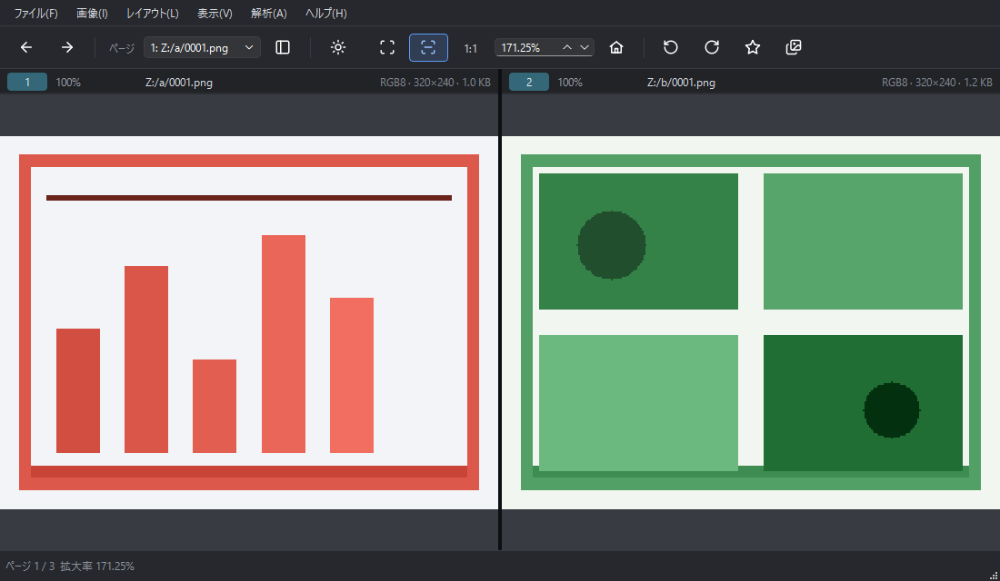

# Heiran

複数の画像を並べて、**同じ位置を同じ倍率で見比べる**ための Windows 用イメージビューアです。
パン、ズーム、回転、ページ送りがすべての画像で連動し、違いを数値と図で確かめられます。

## 主な機能

表示:

- 画像を任意の行列に並べ、パン / ズーム / 回転 / 反転 / ページ送りを同期します。
  画像ごとに同期を切って、倍率、ガンマ、回転、反転、チャネルを変えることもできます
- 露出の調整と、チャネル表示 (カラー / グレー / R / G / B / A)
- 拡大時と縮小時の補間方法を選べます
- 色管理。埋め込みの ICC プロファイルから、画面のプロファイルへ変換して表示します (CMYK も)
- 画素値の情報パネル、ステータスバーの値、ルーペ。値は、表示用の画像ではなく、元の精度のデータから読みます
- 単独表示: 1 つの画像を画面いっぱいに出し、同じ場所を同じ倍率で切り替えて見比べます
- 画像を直接開くと、そのフォルダを画像セットとして扱います。画像セットとセルの設定は、表で編集できます

解析:

- ヒストグラム (2 次元と 3 次元)、波形モニタ、ベクトルスコープ、変化グラフ、画像情報 (メタデータの比較)
- 差分: 絶対値 / 符号付き / 二値 / 色差 (CIEDE2000) / SSIM。PSNR、RMSE などの指標つきで、
  ほかの画像と並べて、同じズームとパンで見られます
- ワイプ: 2 枚を、ドラッグで動かせる境目でつなぎ合わせて見ます
- 画像差分の専用画面では、2 枚を並べて確認し、変更箇所へ移動できます。フォルダ比較では相対パスが同じファイルを順に確認できます
- 範囲を選ぶと、その範囲だけを集計します

形式と入出力:

- PNG、JPEG、BMP、GIF、WebP、AVIF、JPEG XL、TIFF、OpenEXR、HDR、TGA、DPX、PSD などを開けます。
  16bit と 32bit float の画像は、元の精度のまま扱います
- アニメーション (GIF / WebP / APNG) の再生とコマ送り、マルチページ TIFF のページ送り
- 比較の状態 (格子、画像セット、セルごとの設定、差分とワイプ) を、`.hrn` ファイルへ保存できます
- 画面の言語は、英語と日本語です

HEIC には対応していません (HEVC の特許の扱いが重いためです)。

## 動作環境

- Windows (64bit)
- **OpenGL 3.0 以上に対応した GPU とドライバ**。描画に使います。使えない環境では、起動のときに、理由を知らせます。
  グラフィックスドライバを更新してください。リモートデスクトップや仮想マシンなど、GPU のない環境では動かないことがあります
- Microsoft Visual C++ ランタイム (x64)。配布物には入れていません。インストーラが、入っていない、または古い環境を確かめて、
  [Microsoft の配布ページ](https://aka.ms/vs/17/release/vc_redist.x64.exe) を開くかを尋ねます。
  ZIP から使う場合は、先に、最新の `vc_redist.x64.exe` を入れてください

## インストール

[Releases](https://github.com/takecccc/Heiran/releases) から、インストーラ (`Heiran-<版>-win64.exe`) か、
ZIP (`Heiran-<版>-win64.zip`) を入手します。

- インストーラ: 実行します。`.hrn` と画像形式の関連付けを、個別に選べます
- ZIP: 好きな場所へ展開して、`bin` フォルダの `heiran.exe` を起動します

## 使い方

画像ファイルをウィンドウへドラッグアンドドロップするか、**ファイル > 画像を開く...** (<kbd>Ctrl</kbd> + <kbd>O</kbd>) で開きます。
複数のファイルを選ぶと、枚数に合う格子に並びます。

詳しい使い方は、[ユーザーマニュアル](./manual/index.md) にあります。アプリの **ヘルプ > マニュアル** (<kbd>F1</kbd>) からも開けます。
試すための見本は、[examples/](./examples/) にあります (`examples/sample.hrn` を開くと、4 つの画像セットを並べて見られます)。

## ビルドと開発

ビルド、テスト、配布物の作り方は [DEVELOPMENT.md](./DEVELOPMENT.md) にあります。
設計文書は [docs/](./docs/README.md) に、未着手の項目は [open_tasks.md](./open_tasks.md) にあります。

## ライセンス

`Heiran` は [Apache License 2.0](./LICENSE) で公開します。
Copyright 2026 Atelier Takec。著作権の表示は [NOTICE](./NOTICE) にもあります。

依存ライブラリ (Qt、vcpkg のライブラリ、アイコンなど) のライセンスと著作権表示は
[THIRD_PARTY_NOTICES.txt](./THIRD_PARTY_NOTICES.txt) にまとめてあります。
配布物 (インストーラ、ZIP) にも同梱し、アプリの **ヘルプ > Heiran について** でも読めます。
Qt は LGPL-3.0 で、DLL として動的に使っています。
